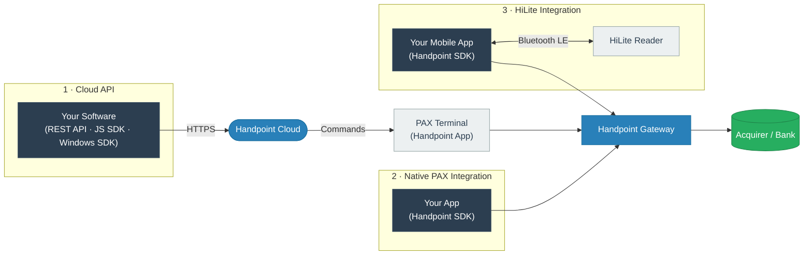

import IntegrationWizard from '@site/src/components/IntegrationWizard';

# Build the payment experience your product needs.

Handpoint gives your software several ways to work with payments.

Connect your software to an in-person payment terminal. Run your own Android application directly on the payment device. Pair a mobile application with a compact reader. Continue working with transactions from your back office without the terminal. And, in Europe, add ecommerce payments.

Different parts of your product can use different approaches.

**Start with the experience you want to create. Then choose the integration path that fits it.**

---

## Already working with Handpoint or one of our payments partners?

You're in the right place.

The Developer Center is the technical home for your Handpoint integration whether you're working directly with Handpoint or through one of our payments or acquiring partners.

Follow the onboarding process you've been given for hardware and commercial setup. Handpoint Integration Support will work with your development team on the technical integration and validation.

## Evaluating Handpoint on your own?

You can use the public Developer Center to understand the integration paths, payment capabilities, supported acquirers and devices before you talk to us.

When you're ready to move from evaluation to building with test credentials and real payment hardware, **talk to Handpoint**. We'll learn what you're building and help determine the appropriate payments setup and next steps.

[**Talk to Handpoint →**](mailto:sales@handpoint.com)

---

## Before you build

### In-person development uses real payment hardware.

If you're working through a Handpoint reselling partner, follow the hardware process provided by that partner. If you're working directly with Handpoint, we'll help coordinate the appropriate development hardware as part of the integration process.

### You'll need test credentials.

Handpoint provides the test credentials your software needs for the payment setup you're integrating.

The exact credentials depend on the acquirer and integration path. For some integrations — particularly Android SDK integrations — we'll first work through the intended payment experience and technical requirements with your team. In all cases, you will be set up to process transactions against a dummy server to emulate responses, including magic amounts to test specific error scenarios.

Every transaction is encrypted by Handpoint, so you can use any card to test transactions as you develop.

### Your PCI compliance scope is reduced.

Handpoint is a **PCI DSS v4.0 Level 1 Service Provider** and the Android SDK is **PCI-P2PE validated**. Because card data is encrypted at the point of interaction before it reaches your application, ISVs integrating with Handpoint typically qualify for the lightweight SAQ P2PE self-assessment rather than the full SAQ D.

[**Security & Compliance →**](/reference/security-compliance)

### How Handpoint supports your integration

Handpoint Integration Support works directly with your development team throughout the integration.

For each integration, we create a **dedicated Slack channel** with your team. From there, Integration Support can:

- Provide test credentials and integration guides
- Answer technical questions during development
- Help with acquirer- and feature-specific requirements
- Review and validate your test or demo application

Once your application has been validated, Handpoint issues an **app certificate** documenting what was tested and approved. The certificate is issued per application and is required before going live with merchants.

If you're already working with Handpoint or one of our payments partners, follow the onboarding process you've been given. Otherwise, contact your Handpoint Account Manager or [sales@handpoint.com](mailto:sales@handpoint.com) to get started.

---

## Start with the in-person experience you're building.

### Connect your software to a payment terminal.

If your software runs on a POS, browser, server or other system, it can initiate a payment on a separate Handpoint-powered terminal.

Handpoint handles the secure card interaction on the terminal and returns the transaction result to your software.

Your software can be written in any language that can call the Handpoint Cloud API. JavaScript and Windows SDKs are also available for those environments.

**Start with:** Cloud API 
**Also available:** [JavaScript SDK](/reference/javascript-sdk-integration-guide) · [Windows SDK](/reference/windows-sdk-integration-guide)

[**Cloud API integration guide →**](/reference/cloud-api-integration-guide)

### Put your software on the payment terminal.

If your Android application runs directly on a supported PAX payment terminal, you can embed Handpoint payment libraries inside it.

**There is one merchant-facing application: yours.**

Use this when the payment device should also be part of your product — for example, tableside ordering and payment, mobile POS, ticketing, parking or another purpose-built merchant workflow.

**Start with:** Android SDK — PAX

[**Android PAX integration guide →**](/reference/android-pax-integration-guide)

### Take payments from a mobile application.

If your Android or iOS application is for highly mobile scenarios and needs a terminal that is small and portable, it can pair with a compact HiLite Bluetooth payment reader.

[**Android HiLite integration guide →**](/reference/android-hilite-integration-guide) 
[**iOS HiLite integration guide →**](/reference/ios-hilite-integration-guide)

### You don't have to choose just one.

Different parts of the same product — or even the same merchant operation — can use different payment experiences.

A restaurant might run its application directly on a handheld at the table while a cloud POS controls another terminal at the counter. A field-service application might use a compact reader in the field while the back office handles later payment operations without a terminal.

**Choose the experience for each workflow, not one integration model for everything.**

---

## See what your setup supports.

Handpoint works across multiple acquirers and integration paths. While Handpoint offers a single integration path to work with many acquirers, the payment capabilities available to you can differ between them.

Use the **Acquirer** and **Integration Path** selectors at the top of the Developer Center to choose the combination you're building with.

Then open **Functionalities** to see what that setup supports and how each payment flow works.

You can explore capabilities such as sales, refunds, reversals, preauthorizations, tips, tip adjustments, tokenization and remote payments based on the acquirer and integration path you've selected.

[**EPI →**](/acquirers/epi) · [**TSYS →**](/acquirers/tsys) · [**EmerchantPay →**](/acquirers/emerchantpay) · [**Paystrax →**](/acquirers/paystrax) · [**PAYSAFE →**](/acquirers/paysafe)

---

## Build the payment workflows your product needs.

Choosing how your software connects to Handpoint is only the beginning. Your product can control what happens during the payment, continue working with the transaction afterward, and support workflows that don't require the cardholder to be at a terminal.

### During checkout

Take a sale. Open a preauthorization when the final amount isn't known yet. Modify the authorization, including incremental auth where supported. Collect a tip. Tokenize the card as part of the payment.

The exact capabilities available depend on the acquirer and integration path you've selected.

**Sales · Preauthorizations · Authorization adjustments · Tips · Tokenization**

### After the customer and terminal are gone

Your software can continue working with supported transactions from **your back office**.

Capture a preauthorization. Add a tip to an EMV transaction taken earlier. Refund or reverse a transaction. Perform supported payment operations without asking the cardholder to return to the terminal.

[**Back Office integration guide →**](/reference/backoffice-integration-guide)

### Recognize the cardholder or use the card later

An in-person card interaction can produce a persistent payment token that your software can associate with its own customer record.

That lets your product recognize a returning cardholder without storing card data. For example, your software could associate a transaction with an existing customer and automatically send a receipt to the email address already stored for that customer.

For eligible card-on-file workflows, the token can also be used for supported later payments without presenting the physical card again.

**Cardholder recognition · Payment tokens · Card on file · Later payments**

### Take a payment when the cardholder isn't at the terminal

Some payment workflows don't begin with an in-person checkout at all.

Use supported MOTO capabilities for phone orders, back-office payments and other eligible card-not-present transactions.

Supported workflows can include remote sales, refunds and preauthorizations. For example, a restaurant could take a catering order by phone and preauthorize the payment remotely.

[**MOTO guide →**](/reference/moto-guide)

### Recover when you're not sure what happened

A lost connection does not necessarily mean a payment failed.

If communication is interrupted around a transaction, determine the transaction state before initiating another payment.

Handpoint provides transaction-recovery patterns so your software can handle uncertain outcomes without simply asking the customer to try the card again and risking a duplicate payment.

[**Transaction recovery →**](/reference/transaction-recovery)

### Route payments around the way your merchants process.

Some merchants need more than one merchant account, acquirer or processing relationship behind the same payment experience.

Handpoint can use card information and merchant configuration to determine how a transaction should be handled. For example, a merchant can route credit cards to one acquirer and Interac debit to another, or use a direct American Express relationship alongside a different acquirer for Visa and Mastercard.

BIN information can also be used within the transaction flow to apply card-specific rules — for example, allowing debit cards while declining credit cards for a particular payment use case.

Multi-MID supports products that need to work with multiple merchant accounts behind the same software or terminal experience.

**Multi-acquirer routing · BIN-based routing and rules · Multi-MID**

[**Multi-MID guide →**](/reference/multi-mid)

---

## Taking payments online in Europe?

Handpoint also supports ecommerce for European merchants through SmartBoard. No payment terminal is required.

Choose the integration method based on the checkout experience you want to build.

### Hosted Payment Page

Send the customer to a Handpoint-hosted checkout, or display the hosted checkout within your experience.

### Hosted Payment Fields

Embed gateway-hosted payment fields within your own checkout so your application controls the surrounding experience without card data passing through your server.

### Direct Integration

Build directly against the ecommerce gateway when you need greater control over the checkout and payment flow.

### Pay By Link

Create a payment link, QR code or button for remote payment without building a complete checkout.

Shopping-cart integrations and mobile ecommerce SDKs are also available.

[**Explore SmartBoard ecommerce →**](/acquirers/smartboard)

---

## Not sure which path fits?

Tell us what you're trying to build.

Choose your region, integration approach, acquirer and the payment capabilities you need. We'll use your selections to understand your requirements and help determine the right setup for your integration.

<IntegrationWizard />

The wizard takes you through:

**Region → Integration → Acquirer → Features → Your Plan**

At **Your Plan**, you'll see a summary of what you selected. Send your selections to Handpoint and our team can review what you're trying to build and help you determine the right integration approach.

---

## Build for deployment and scale.

### Set up merchants and terminals.

If your organization is responsible for boarding Handpoint merchants, the TMS APIs can integrate supported merchant and terminal setup into your existing onboarding workflows.

If your payments partner is responsible for merchant onboarding and terminal setup, they may manage this part of the process for you.

[**TMS APIs →**](/back-office/tms-apis)

### Manage terminals remotely.

Use Device Control Commands to manage supported terminal settings and operations remotely, including commands such as reboot, locale, brightness, unattended mode and password protection.

[**Device Control Commands →**](/back-office/device-commands)

### Bring transaction data into your product.

Use the Transaction Feed API to bring Handpoint transaction data into your own reporting, reconciliation, merchant-facing products, support tools and operational workflows.

[**Transaction Feed API →**](/back-office/transaction-feed-api)

---

## Start from a merchant workflow.

If you're designing payments for a particular kind of business, start with the way that merchant actually works.

The guides connect merchant workflows to the Handpoint payment capabilities and integration approaches that can support them.

### Restaurants & hospitality

Counter and tableside checkout, tabs and preauthorizations, tipping and tip adjustment, cardholder recognition, card-on-file, remote payments and transaction recovery.

[**Restaurant payments guide →**](/guides/restaurant-guide)

### Field service

Payments at the job site, mobile software and portable readers, returning customers, card-on-file and back-office payment operations.

[**Field service payments guide →**](/guides/field-service-guide)

### Practice management

Front-desk and provider workflows, multiple merchant accounts, stored payment credentials and remote payments.

[**Practice management payments guide →**](/guides/practice-management-guide)

### Salons & spas

Counter and mobile checkout, tipping, returning customers and merchant-account structures.

[**Salons & spas payments guide →**](/guides/salons-guide)

### Stadiums & events

High-throughput, mobile and purpose-built payment experiences.

[**Stadiums & events payments guide →**](/guides/events-guide)

These are starting points, not a complete list of merchant workflows Handpoint can support.

---

## Already know how you want to integrate?

Go directly to the implementation guide.

[**Cloud API →**](/reference/cloud-api-integration-guide) 
Connect cloud or server-side software to a Handpoint-powered payment terminal.

[**Android SDK — PAX →**](/reference/android-pax-integration-guide) 
Put your own Android application directly on a supported PAX payment terminal.

[**Android SDK — HiLite →**](/reference/android-hilite-integration-guide) 
Connect an Android application to a compact payment reader.

[**iOS SDK — HiLite →**](/reference/ios-hilite-integration-guide) 
Connect an iOS application to a compact payment reader.

[**JavaScript SDK →**](/reference/javascript-sdk-integration-guide)

[**Windows SDK →**](/reference/windows-sdk-integration-guide)

[**Back Office APIs →**](/reference/backoffice-integration-guide) 
Perform supported server-side payment operations without a new terminal interaction.

[**Supported Devices →**](/reference/devices)

---

## Ready to build?

### Already working with Handpoint or one of our payments partners?

Continue through the integration process you've been given. Handpoint Integration Support will work with your development team on the technical integration and validation.

### Evaluating Handpoint independently?

Talk to Handpoint.

We'll learn what you're building and help determine the appropriate payments setup, integration path and next steps for moving from evaluation to development.

[**Talk to Handpoint →**](mailto:sales@handpoint.com)
