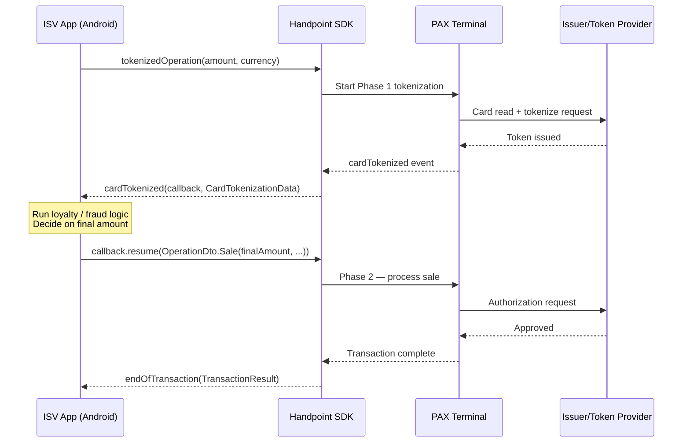
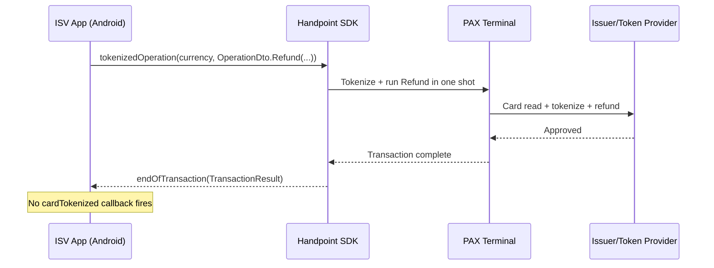
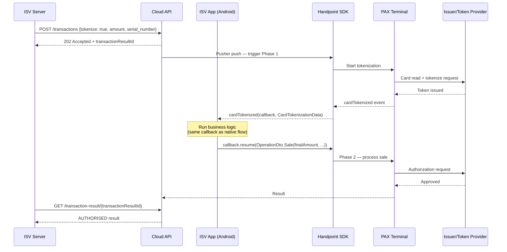

## Tokenized Operation

#### What this does

Reads and tokenizes the card in **Phase 1**, then pauses while your application runs business logic — loyalty lookup, fraud check, amount adjustment. In **Phase 2** you call `resume(OperationDto)` with the final operation. The amount charged in Phase 2 can differ from the amount shown in Phase 1. This "modify" capability is the defining feature of this flow.

**Three integration paths:**

| Flow | Entry point | `cardTokenized` fires? | Use when |
|---|---|---|---|
| Native two-phase | `tokenizedOperation(amount, currency)` on device | Yes — ISV calls `resume()` | Any scenario where Phase 2 operation depends on real-time server logic |
| Native seamless | `tokenizedOperation(currency, OperationDto)` on device | No | Token the card and immediately run a Refund, SaleReversal, or RefundReversal |
| Cloud-triggered | `POST /transactions` with `tokenize: true` | Yes — same SDK callback | Same as native two-phase, but Phase 1 is triggered remotely |

#### When to use it

- **Loyalty programs** — look up or enroll the cardholder by token, apply a discount, then call `resume()` with the adjusted amount. If the token is new, store it for future charges; if existing, load rewards.
- **Dynamic pricing** — inspect `CardTokenizationData` (brand, country, tenderType) before deciding on surcharges or category rates.
- **Tokenize-and-immediately-reverse** — use the seamless variant to tokenize a card then immediately run a SaleReversal or Refund (e.g. loyalty-only tap that credits points but does not charge).
- **Cloud-orchestrated flows** — server triggers Phase 1 on a remote terminal; ISV backend receives the `cardTokenized` event via the Android SDK and drives Phase 2.

For purely storing a card without charging it, see [Tokenization](/functions/tokenization).
For MOTO back-office charges using a stored token (no terminal), see [MOTO](/functions/moto).

#### Implementation notes

1. **Native two-phase flow** — call `tokenizedOperation(amount, currency)` from the device. The SDK fires `cardTokenized(callback: ResumeCallback, cardTokenizationData: CardTokenizationData)` on your `Events.CardTokenization` listener. Call one of:
   - `callback.resume(OperationDto.Sale(amount, currency, SaleOptions()))` — proceed; pass a `Sale`, `Refund`, `SaleReversal`, or `RefundReversal`; the amount here is what gets charged
   - `callback.finishWithoutCardOperation()` — end gracefully without charging; token is still issued
   - `callback.cancel()` — cancel entirely
2. **Native seamless — Refund** — call `tokenizedOperation(currency, OperationDto.Refund(...))`. Requires a card tap; the terminal tokenizes and immediately runs the refund. No `cardTokenized` callback fires.
3. **Native seamless — SaleReversal** — call `tokenizedOperation(currency, OperationDto.SaleReversal(...))`. No card tap required; the reversal is sent via `originalTransactionID`. `cardToken` is empty in the result; result `type` is `VOID_SALE`.
4. **Cloud-triggered flow** — send `POST /transactions` with `"tokenize": true`. The Cloud API pushes the command to the terminal via Pusher, triggering Phase 1. The Android SDK fires the same `cardTokenized` callback. Phase 2 is still driven from the Android SDK on the device. The `POST /transactions` response returns a `transactionResultId` — poll `GET /transaction-result/{id}` or use `callbackUrl` for the final result. Result `transactionOrigin`: `CLOUD`.
5. **Amount modification** — the `amount` field in `POST /transactions` (cloud flow) or the first arg to `tokenizedOperation()` (native flow) is what appears on the terminal during Phase 1. The actual charged amount is the `amount` inside `OperationDto.Sale` in `resume()`. These can differ.
6. **Empty token** — if no token provider is configured for the merchant, `cardTokenized` still fires with `token = ""` and `cardBrand = ""`. The ISV must decide: call `resume()` to charge anyway (no token stored) or `cancel()`. Check `cardTokenizationData.token.isNullOrBlank()`.
7. **Cancel delivers the token** — calling `callback.cancel()` still completes tokenization. The result has `finStatus: CANCELLED` and `type: TOKENIZED_OPERATION`, but `cardToken` is populated. Store the token even on cancel.
8. **`transactionOrigin`** — `STANDALONE` for all native SDK flows (two-phase and seamless); `CLOUD` for cloud-triggered flows.

{/* ACQUIRER_NOTE_INJECTION_POINT */}

#### Sequence diagrams

**Flow 1 — Native two-phase:**



**Flow 2 — Native seamless (Refund / SaleReversal / RefundReversal):**



**Flow 3 — Cloud-triggered two-phase:**



#### Code

<Tabs groupId="integration-path">
<TabItem value="cloud-api" label="Cloud API">

Trigger a two-phase tokenize-and-modify from your server. A physical terminal is required — the Cloud API pushes the command to the terminal via Pusher; the same `cardTokenized` callback fires on the Android SDK.

```http
POST https://cloud.handpoint.com/transactions
ApiKeyCloud: YOUR_MERCHANT_API_KEY
Content-Type: application/json

{
  "operation": "sale",
  "amount": "10.00",
  "currency": "USD",
  "terminal_type": "PAXA920",
  "serial_number": "YOUR_TERMINAL_SERIAL",
  "tokenize": true,
  "transactionReference": "2bfde1fc-23b1-4c67-93d9-1d4a557f4d4f"
}
```

`amount` is a **major-unit decimal string** and is shown on the terminal display during Phase 1. The actual charged amount is set in `OperationDto.Sale` when the Android SDK calls `callback.resume()`.

Response (`202 Accepted`):

```json
{
  "statusMessage": "Operation Accepted",
  "transactionResultId": "082159946-20241022T143027",
  "transactionReference": "2bfde1fc-23b1-4c67-93d9-1d4a557f4d4f"
}
```

Poll for the final result:

```http
GET https://cloud.handpoint.com/transaction-result/082159946-20241022T143027
ApiKeyCloud: YOUR_MERCHANT_API_KEY
```

The `transactionOrigin` field in the result will be `CLOUD`. Phase 2 is driven entirely from the Android SDK — the server only triggers Phase 1 and polls for the result.

</TabItem>
<TabItem value="android-pax" label="Android (PAX)">

**Two-phase flow** — card is physically present; SDK pauses after tokenization for integrator logic:

```kotlin
// Phase 1: Terminal reads card, tokenizes it, fires cardTokenized event
hapi.tokenizedOperation(BigInteger("1000"), Currency.USD)

// Implement Events.CardTokenization in your events listener:
override fun cardTokenized(callback: ResumeCallback, cardTokenizationData: CardTokenizationData) {
    val token = cardTokenizationData.token          // token for loyalty lookup, fraud check, etc.
    val cardBrand = cardTokenizationData.cardBrand  // e.g. "Visa"
    val tipAmount = cardTokenizationData.tipAmount  // tip collected on-screen (if any)

    // Apply business logic — loyalty lookup, fraud check, tip adjustment, etc.

    // Option A: proceed with the Sale
    callback.resume(OperationDto.Sale(
        amount = BigInteger("1000"),
        currency = Currency.USD,
        options = SaleOptions()
    ))

    // Option B: skip the charge but finish gracefully (e.g. loyalty-only scan)
    // callback.finishWithoutCardOperation()

    // Option C: cancel the entire operation
    // callback.cancel()
}

// Phase 2 result arrives in endOfTransaction:
override fun endOfTransaction(result: TransactionResult, device: Device) {
    if (result.finStatus == FinancialStatus.AUTHORISED) {
        // result.transactionID — store for potential reversal
        // result.cardToken — the token for future use
    }
}
```

**Seamless variant** — tokenize and execute back-to-back; no `cardTokenized` event fires:

```kotlin
// Supported operations: SaleReversal, Refund, RefundReversal
// Example: linked refund — card is tokenized then immediately refunded
val operation = OperationDto.Refund(
    amount = BigInteger("1000"),
    currency = Currency.USD,
    originalTransactionID = "01236fc0-8192-11eb-9aca-ad4b0e95f241",
    options = RefundOptions()
)
hapi.tokenizedOperation(Currency.USD, operation)

// Single endOfTransaction result fires when both steps complete
```

</TabItem>
<TabItem value="android-hilite" label="Android (HiLite)">

```kotlin
// Two-phase flow — same API as PAX
hapi.tokenizedOperation(BigInteger("1000"), Currency.USD)

override fun cardTokenized(callback: ResumeCallback, cardTokenizationData: CardTokenizationData) {
    // inspect token, then proceed with Sale:
    callback.resume(OperationDto.Sale(
        amount = BigInteger("1000"),
        currency = Currency.USD,
        options = SaleOptions()
    ))
}
```

</TabItem>
<TabItem value="ios-hilite" label="iOS (HiLite)">

<NotSupported
  reason="The tokenizedOperation two-phase flow is not available on iOS HiLite."
  useInstead="Android SDK (PAX or HiLite) or Cloud API"
/>

</TabItem>
<TabItem value="cordova" label="Cordova">

<NotSupported
  reason="tokenizedOperation is not implemented in the Cordova plugin."
  useInstead="Android SDK directly or Cloud API"
/>

</TabItem>
</Tabs>

#### Parameters

#### Result fields

| Scenario | `finStatus` | `type` | `cardToken` | `transactionOrigin` |
|---|---|---|---|---|
| Two-phase → `resume()` AUTHORISED | `AUTHORISED` | `SALE` | Populated | `STANDALONE` or `CLOUD` |
| Two-phase → `cancel()` | `CANCELLED` | `TOKENIZED_OPERATION` | **Populated** | `STANDALONE` or `CLOUD` |
| Seamless Refund | `AUTHORISED` | `REFUND` | Populated | `STANDALONE` |
| Seamless SaleReversal | `AUTHORISED` | `VOID_SALE` | Empty | `STANDALONE` |

**Cloud API** — `POST /transactions` with `"tokenize": true`:

| Parameter | Type | Required | Description |
|---|---|---|---|
| `operation` | string | Yes | `"sale"` — the operation type for Phase 2 |
| `amount` | string | Yes | Phase 1 display amount in **major currency units** (e.g. `"10.00"` for $10.00). The actual charged amount is set in `resume()` on the Android SDK |
| `currency` | string | Yes | ISO 4217 currency code |
| `terminal_type` | string | Yes | PAX terminal model (e.g. `"PAXA920"`) |
| `serial_number` | string | Yes | Terminal serial number |
| `tokenize` | boolean | Yes | Must be `true` to trigger the two-phase tokenize-and-modify flow |
| `transactionReference` | string | Recommended | UUID v4 for idempotency |

**Android SDK** — `tokenizedOperation(amount, currency)` (two-phase):

| Parameter | Type | Description |
|---|---|---|
| `amount` | `BigInteger` | Sale amount in minor currency units (e.g. `BigInteger("1000")` = $10.00) |
| `currency` | `Currency` | Currency of the sale |

**`CardTokenizationData` fields** (received in the `cardTokenized` callback):

| Field | Type | Description |
|---|---|---|
| `token` | `String` | Card token — store for future charges |
| `expiryDate` | `String` | Card expiry date |
| `cardBrand` | `String` | Card brand (e.g. `"Visa"`, `"Mastercard"`) |
| `tenderType` | `TenderType` | How the card was presented (chip, contactless, etc.) |
| `tipAmount` | `BigInteger` | Tip collected on-screen (zero if no tip was collected) |
| `issuerCountryCode` | `CountryCode` | Issuer country |
| `languagePref` | `String` | Cardholder's language preference |

**`ResumeCallback` methods** (call one to drive Phase 2):

| Method | Effect |
|---|---|
| `callback.resume(OperationDto.Sale(...))` | Proceed with the charge — pass a concrete `OperationDto` subclass (`Sale`, `Refund`, `SaleReversal`, or `RefundReversal`) |
| `callback.finishWithoutCardOperation()` | End the session without charging — token is still issued |
| `callback.cancel()` | Cancel the operation entirely |

#### Errors

| Code | Meaning | Recovery |
|---|---|---|
| `CARD_READ_ERROR` | Terminal failed to read the card | Ask cardholder to retry |
| `TOKENIZATION_NOT_ENABLED` | Not configured for this merchant | Contact Handpoint team |
| `DECLINED` | Issuer declined in Phase 2 | Ask cardholder for another card |

#### Testing

<Tabs groupId="integration-path">
<TabItem value="android-pax" label="Android (PAX)">

| Scenario | How to trigger |
|---|---|
| Two-phase happy path | `hapi.tokenizedOperation()` → receive `cardTokenized` → call `callback.resume()` — verify `AUTHORISED` and `result.cardToken` in EndOfTransaction |
| Abandon after tokenization | Call `callback.finishWithoutCardOperation()` — verify no charge, but token is issued |
| Cancel | Call `callback.cancel()` — verify transaction terminates cleanly |

</TabItem>
<TabItem value="cloud-api" label="Cloud API">

| Scenario | How to trigger |
|---|---|
| Two-phase happy path | `POST /transactions` with `tokenize: true` → Android SDK fires `cardTokenized` → call `callback.resume(OperationDto.Sale(...))` → verify `AUTHORISED` in `GET /transaction-result/{id}` |
| Phase 1 amount differs from Phase 2 | Pass different amount in `resume()` — verify the charged amount matches the `resume()` amount in the result |
| Cancel after tokenization | Call `callback.cancel()` — verify no charge in transaction feed |

</TabItem>
</Tabs>
